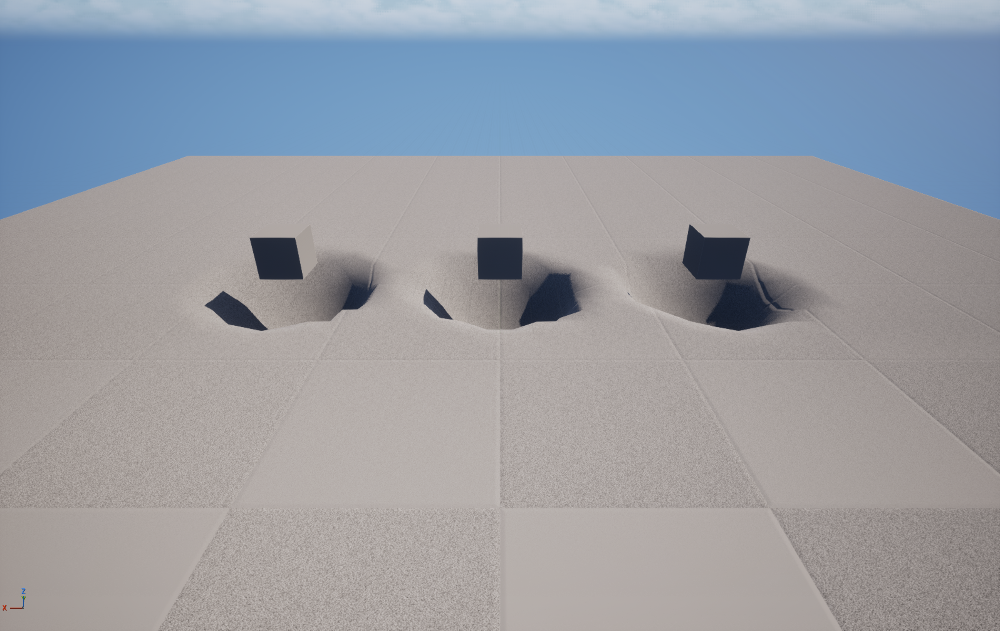

# Scorched3D — Modern Unreal Remake

A modern, single-player-first reimagining of the classic artillery game
[Scorched3D](https://github.com/aske/scorched3d), built in **Unreal Engine 5.8** with AI-assisted
tooling (Unreal MCP).

## Status

✅ **Phase 1 terrain spike PROVEN.** Runtime destructible craters work: a C++ `ADynamicMeshActor`
generates a heightfield ground grid and carves sine-profile craters at runtime by lowering the
surface vertices (a direct port of the legacy `DeformLandscape` model), with collision rebuilt so
dropped physics objects settle into the crater. The project is now a C++ module (was Blueprint-only).
Next up is Phase 2 (core gameplay loop).

- **Strategy:** Hybrid port (extract the hard, valuable algorithms; rebuild glue/state/networking the
  Unreal way) · Modern reimagining · Single-player / hotseat first.
- Read the full analysis: **[`docs/01-porting-research.md`](docs/01-porting-research.md)**

## What we're keeping from the legacy game

| Keep (port/mine) | Replace (Unreal-native) |
|------------------|-------------------------|
| Destructible-terrain crater math (the signature feel) | OpenGL/GLSL renderer |
| The data-driven, composable weapon system *design* | Legacy UI/dialogs |
| The iterative AI aiming algorithm | Lockstep netcode / fixed-point determinism |
| Per-weapon ballistics tuning model + wind | Server-centric state machine |

## Requirements

- **Unreal Engine 5.8** (the `.uproject` pins `EngineAssociation: 5.8`)
- **Python 3** — only for the MCP browser tool (stdlib only, no packages)

Enabled engine plugins: `ModelContextProtocol`, `EditorToolset`, `ModelingToolsEditorMode`,
`GameplayStateTree`, `Terminal`.

## Repository layout

```
Scorched3dUnreal.uproject   UE 5.8 project (MCP + editor toolset plugins enabled)
Config/                     Project & engine config
Content/                    Game assets
docs/                       Research & design documents (+ docs/wiki/ working-notes wiki)
tools/                      Dev tooling (MCP browser, working-notes wiki server)
.tmp/                       Legacy source checkout (git-ignored, reference only)
```

Build/intermediate dirs (`Binaries/`, `Intermediate/`, `Saved/`, `DerivedDataCache/`) and the
legacy source under `.tmp/scorched3d-legacy/` are **not** tracked by git.

## AI tooling — Unreal MCP

The editor is driven over the Model Context Protocol. With Unreal running and the MCP plugin active,
the server listens at **`http://localhost:8000/mcp`**. It's a *gateway* — it exposes only
`list_toolsets`, `describe_toolset`, and `call_tool`, which reach the underlying editor toolsets
(actors, assets, blueprints, scene, static meshes, materials, primitives, etc.).

### MCP browser

`tools/mcp-browser-serve.py` is a local same-origin proxy + web UI that crawls the live MCP server so
you can browse every toolset and tool schema, and invoke tools directly from the page.

```bash
python tools/mcp-browser-serve.py     # then open http://localhost:8765
```

- **Disk cache** (`tools/.mcp-graph-cache.json`, git-ignored) — instant startup; the proxy serves the
  cached graph and only re-crawls on demand.
- **↻ re-crawl** forces a live re-crawl and rewrites the cache.
- **Collapsible toolset groups** with state persisted in `localStorage`, plus filter and a cache-age
  indicator.

The proxy is required because the MCP server speaks SSE only and sends no CORS headers — the browser
page talks to the proxy, which talks to the MCP server.

## Project wiki — working notes & architecture comparison

A small, local, **no-build** wiki for working notes and side-by-side comparisons of our
Unreal-native architecture vs. the legacy Scorched3D design (terrain, weapons, AI aiming,
ballistics & wind, netcode). It's **for us to communicate**: pages are Markdown in the repo, and
the notes/questions thread is a git-tracked JSON, so both the user (in the browser) and Claude
(via file tools) read and write the same store. Questions stay flagged **unanswered** until replied
to — a shared queue.

```bash
python tools/wiki-serve.py     # then open http://localhost:8777
```

- Stdlib-only Python server (`tools/wiki-serve.py`); vanilla front-end, no framework, no npm.
- Content: `docs/wiki/content/*.md` · nav: `docs/wiki/nav.json` · notes: `docs/wiki/notes.json`.
- Claude posts answers with `python tools/wiki-serve.py --as claude` (or by editing `notes.json`).
- How it works: open the wiki and read **How this wiki works**, or
  [`docs/wiki/content/how-it-works.md`](docs/wiki/content/how-it-works.md).

## Phase 1 spike result (proven)

Terrain tech is resolved and **validated in-engine**: UE 5.8 Mesh Terrain is editor-authoring only
(no runtime carve — confirmed at engine source level), so the destructible surface uses a
**GeometryScript `UDynamicMeshComponent` heightfield** (native, no paid dep). See §4 of the research
doc. The Phase 1 spike (`ACraterTerrainActor`) proved runtime craters end-to-end:

- The ground is a flat subdivided grid (`AppendRectangleXY`). `CarveCrater` carves by **lowering each
  surface vertex** within the radius by the legacy sine falloff (`CraterMath::DepthAt`, unit-tested),
  clamped to a bedrock floor — a direct port of `DeformLandscape.cpp:186-233`.
- Collision is rebuilt after each carve, so dropped physics cubes **settle into** the craters.
- **Verified by a deterministic headless test** — `Scorched.CraterCarve.RealDepression` runs the real
  deformation and measures the resulting mesh:

  | Measurement | Value | Meaning |
  |---|---|---|
  | center surface Z | **−287.1** | carved ~287 cm below the original surface (Z=0) |
  | terrain Z outside crater | **0.0** | untouched — flat ground remains flat |
  | highest vertex anywhere | **0.0** | nothing raised above the surface → **no lid possible** |

  Run it editor-closed: `Automation RunTests Scorched.CraterCarve` → `Result={Success}`.

  Side-on view in Simulate — three runtime craters with physics cubes settled into them:

  

**Why a heightfield, not a mesh boolean:** the first approach boolean-subtracted a closed bowl solid
from a closed slab. Even done correctly that yields a closed volume — it produced a visible "lid" over
the crater, on top of earlier coplanar-seam and slab-vs-plane failures. A heightfield is single-valued
(one height per cell), so a lid is geometrically impossible and the whole class of CSG bugs disappears.
This matches what Scorched3D actually does — it's a heightfield game. **Tradeoff:** no overhangs/caves
(which Scorched3D never had); if those are ever wanted, that's when DynamicMesh booleans or voxels
return. (Design/build details: [`docs/superpowers/specs`](docs/superpowers/specs/) +
[`docs/superpowers/plans`](docs/superpowers/plans/).)

## Next step

**Phase 2 — core gameplay loop:** one tank, aim (turret + elevation + power), wind, fire a projectile
(`ProjectileMovementComponent` + per-weapon force model), impact → `CarveCrater`. See §5 of the
research doc.
